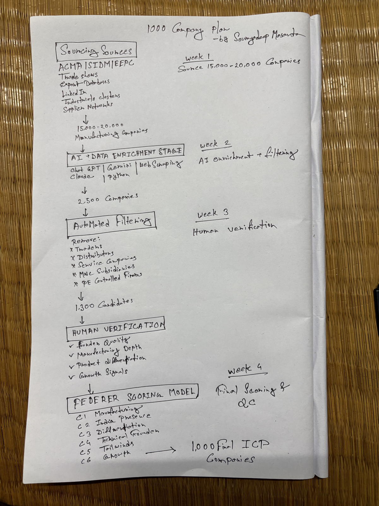

# Federer Manufacturing Research Assignment

> A structured research project that identifies Indian manufacturing companies with the technical depth, leadership quality, differentiation, and growth profile associated with the Federer framework.


## Overview

This submission combines a curated 25-company research dataset, an evidence-led scoring methodology, a scalable sourcing plan, and an interactive Streamlit research tracker. The focus is not on finding manufacturers in general; it is on identifying businesses with defensible, long-term potential.

The framework evaluates companies on manufacturing depth, Indian operating presence, product differentiation, technical leadership, sector tailwinds, and visible growth signals.

## What’s inside

| Deliverable | Description |
| --- | --- |
| [Research dataset](data/federer_company_research.csv) | 25 shortlisted Indian manufacturing companies with evidence, scores, verdicts, and outreach hooks. |
| [Research methodology](docs/research-methodology.md) | The qualification process and Federer evaluation framework. |
| [Sourcing methods](docs/sourcing-methods.md) | Eight high-signal methods for building a quality manufacturing pipeline. |
| [1,000-company proposal](docs/1000-company-proposal.md) | A four-week plan for scaling research from discovery to quality control. |
| [Research tracker](src/federer_research_tracker.py) | Streamlit tool for screening, scoring, and exporting company research. |

## Research process

```text
Discover companies → Qualify manufacturers → Verify evidence → Score against Federer criteria → Prioritize highest-fit targets
```

The sourcing plan moves from a universe of 15,000–20,000 prospects to a final, quality-controlled target list through automation and human verification.



## Federer evaluation framework

| Criterion | What it evaluates |
| --- | --- |
| C1 — Manufacturing depth | Evidence of genuine product and production capability. |
| C2 — India presence | Meaningful operating and manufacturing footprint in India. |
| C3 — Differentiation | Specialized products, technical moats, IP, and certifications. |
| C4 — Technical decision-maker | Founder or leadership depth in engineering, science, or manufacturing. |
| C5 — Industry tailwinds | Exposure to attractive, structurally growing markets. |
| C6 — Growth signals | Expansion, certifications, hiring, exports, launches, or other momentum. |

## Run the research tracker

```bash
git clone https://github.com/Soumyadeepmasanta/federer-assignment.git
cd federer-assignment
python -m venv .venv
source .venv/bin/activate  # Windows: .venv\Scripts\activate
pip install -r requirements.txt
streamlit run src/federer_research_tracker.py
```

The tracker loads the included research dataset on start-up and supports company analysis, scoring, pipeline filtering, fail-list tracking, and CSV export.

## Repository structure

```text
federer-assignment/
├── assets/                 # Research-plan visual
├── data/                   # Curated company research dataset
├── docs/                   # Methodology and scaling proposal
├── src/                    # Streamlit research tracker
├── requirements.txt
└── README.md
```

## Notes on evidence

This project is a research assignment built from publicly available sources. Scores represent the evidence available during research and are intended to support further diligence, not replace it.

## Author

**Soumyadeep Masanta**

[GitHub](https://github.com/Soumyadeepmasanta)
